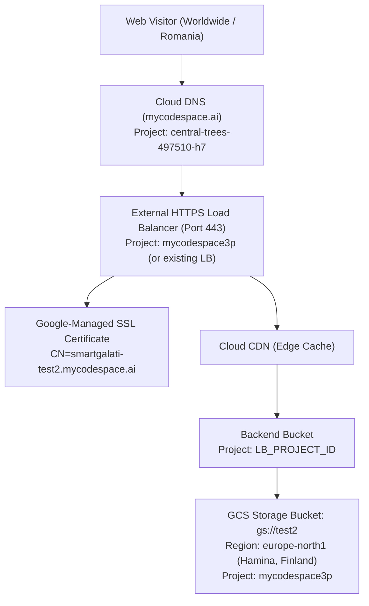

# Google Cloud Storage (GCS) & HTTPS Load Balancer Deployment Suite

This directory contains the production-grade deployment suite for static websites on **Google Cloud Storage (GCS)**, fronted by an **External Application Load Balancer** with **Google-Managed SSL** and **Cloud CDN**.

The suite is fully parameterized and incorporates all lessons learned from previous deployments, specifically engineered for multi-project Google Cloud setups.

---

## 1. Architecture & Multi-Project Topology

The deployment decouples resources across Google Cloud projects and regions according to operational requirements:



| Component | Target Value | GCP Project | Rationale |
| :--- | :--- | :--- | :--- |
| **GCS Bucket** | `gs://test2` | `mycodespace3p` | Dedicated project for new website resources. |
| **GCS Location** | `europe-north1` | `mycodespace3p` | Hamina, Finland: low-latency, cost-effective regional storage for Romania and Europe. |
| **Load Balancer** | `chessclub-test2` | `mycodespace3p` | New External Application Load Balancer (IPv4, Target Proxy, Forwarding Rule). |
| **Cloud DNS** | `smartgalati-test2.mycodespace.ai` | `central-trees-497510-h7` | Authoritative DNS zone `mycodespace` resides here. |
| **Alternative LB** | `chessclub-site` | `central-trees-497510-h7` | Supports adding the new website to an existing load balancer without creating a new IP. |

---

## 2. Key Lessons Learned Incorporated

1. **Multi-Project Parameterization & Explicit Flags**:
   - Every `gcloud` command explicitly passes `--project="${...}"`.
   - Prevents commands from inadvertently deploying into whichever project happens to be set in local `gcloud config`.
   - Resource creation (`mycodespace3p`) and DNS management (`central-trees-497510-h7`) operate seamlessly together.

2. **Automated Non-Interactive API Enablement**:
   - In fresh or under-utilized projects, GCP APIs (e.g. `compute.googleapis.com`, `storage.googleapis.com`, `dns.googleapis.com`) may be disabled, prompting interactive `(y/N)?` confirmation that causes scripts to hang or fail.
   - All scripts verify and enable required APIs non-interactively using `--quiet`.

3. **Domain-Restricted Sharing (Org Policy HTTP 412) & Propagation Retry**:
   - Google Cloud organizations frequently enforce `constraints/iam.allowedPolicyMemberDomains`, which blocks `allUsers` permissions required for static websites.
   - `02-configure-website.sh` detects HTTP 412 errors, generates a project-level override policy, applies it, and includes an eventual consistency retry loop to wait for propagation.

4. **Multi-Website Hosting on Existing Load Balancers (Cross-Project Capable)**:
   - Future executions do not need to create a dedicated load balancer and IP for every site.
   - `04b-add-to-existing-loadbalancer.sh` adds the new website to an existing load balancer (in the same or a different project) by:
     - Creating a Google-managed certificate for the new domain.
     - Appending the certificate to the existing Target HTTPS Proxy (preserving existing site certificates).
     - Creating a Backend Bucket pointing to the GCS bucket.
     - Adding a Host Rule / Path Matcher to the existing URL Map.

5. **GCS Global Bucket Namespace Collision Handling**:
   - GCS bucket names are globally unique across all Google Cloud accounts worldwide.
   - If a short name like `test2` is already owned by another party, `01-create-bucket.sh` provides clear diagnostics and recommends `test2-${PROJECT_ID}`.

6. **Automated Cloud DNS Record Sync & Status Monitoring**:
   - `05-configure-dns.sh` automatically retrieves the load balancer IP and creates/updates the `A` record in `central-trees-497510-h7`.
   - `check-status.sh` provides end-to-end diagnostics for DNS resolution, SSL certificate provisioning progress (`PROVISIONING` -> `ACTIVE`), and HTTP/3 / Cloud CDN caching.

---

## 3. Configuration File (`config.env`)

All scripts automatically source `scripts/gcs/config.env` if present. You can adjust parameters globally by editing this file or by passing positional arguments or environment variables to individual scripts:

```bash
# Core Project where Storage and Load Balancer are created
export PROJECT_ID="mycodespace3p"

# DNS Project where Cloud DNS zone lives
export DNS_PROJECT_ID="central-trees-497510-h7"
export DNS_ZONE="mycodespace"

# Domain
export SUBDOMAIN="smartgalati-test2"
export PARENT_DOMAIN="mycodespace.ai"
export DOMAIN="${SUBDOMAIN}.${PARENT_DOMAIN}"

# Storage Bucket
export BUCKET_NAME="test2"
export LOCATION="europe-north1"        # Regional to Finland
export STORAGE_CLASS="STANDARD"

# Load Balancer Project (defaults to PROJECT_ID; can point to external project for existing LB)
export LB_PROJECT_ID="${PROJECT_ID}"
export LB_NAME_PREFIX="chessclub-test2"
export EXISTING_LB_NAME="chessclub-site"
```

---

## 4. Execution Workflow

### Step 1: Create the Storage Bucket in Finland
Creates `gs://test2` in `mycodespace3p` with regional storage in Finland (`europe-north1`):
```bash
./scripts/gcs/01-create-bucket.sh
```
*(Override syntax: `./01-create-bucket.sh [BUCKET_NAME] [LOCATION] [STORAGE_CLASS] [PROJECT_ID]`)*

---

### Step 2: Configure Bucket for Website Hosting & Public Access
Sets `index.html` / `404.html`, disables PAP, grants `allUsers` read permissions, and handles Org Policy overrides if needed:
```bash
./scripts/gcs/02-configure-website.sh
```
*(Override syntax: `./02-configure-website.sh [BUCKET_NAME] [PROJECT_ID]`)*

---

### Step 3: Build and Deploy the Static Site
Compiles the Astro static site and synchronizes `dist/` to GCS with optimal Cache-Control headers (1 year for immutable `_astro/*`, 5 minutes for HTML):
```bash
./scripts/gcs/03-deploy-site.sh
```
*(Override syntax: `./03-deploy-site.sh [BUCKET_NAME] [SITE_DIR] [PROJECT_ID]`)*

---

### Step 4: Setup HTTPS Routing

#### Option A: Create a NEW Load Balancer in `mycodespace3p` (Default)
Reserves a new static external IP, creates a Google-managed certificate, backend bucket, URL map, HTTPS proxy, and forwarding rule:
```bash
./scripts/gcs/04-setup-https-loadbalancer.sh
```

#### Option B: Add Website to an EXISTING Load Balancer (Cross-Project Capable)
If you want to reuse an existing load balancer (e.g. `chessclub-site` in `central-trees-497510-h7` or an existing LB in `mycodespace3p`):
```bash
./scripts/gcs/04b-add-to-existing-loadbalancer.sh test2 smartgalati-test2.mycodespace.ai central-trees-497510-h7 chessclub-site
```
This updates the existing URL Map and HTTPS proxy without interrupting existing traffic or allocating another IP.

---

### Step 5: Configure DNS in `central-trees-497510-h7`
Creates or updates the `A` record for `smartgalati-test2.mycodespace.ai` in project `central-trees-497510-h7`:
```bash
./scripts/gcs/05-configure-dns.sh
```
*(Automatically discovers the Load Balancer IP if not passed explicitly).*

---

### Step 6: Verify Deployment & Monitor Certificate Issuance
Monitors DNS propagation, Google-managed SSL status (`PROVISIONING` -> `ACTIVE`), and live HTTPS connectivity:
```bash
./scripts/gcs/check-status.sh
```
*(Note: Google-managed SSL certificates typically take 10–25 minutes to become `ACTIVE` once Google's CA detects the DNS record).*
